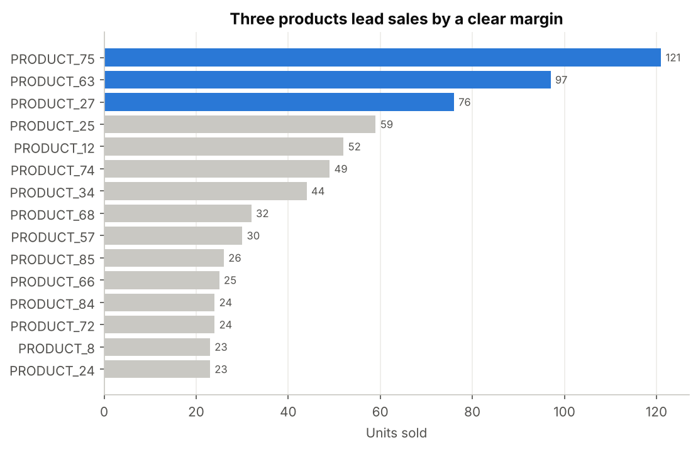
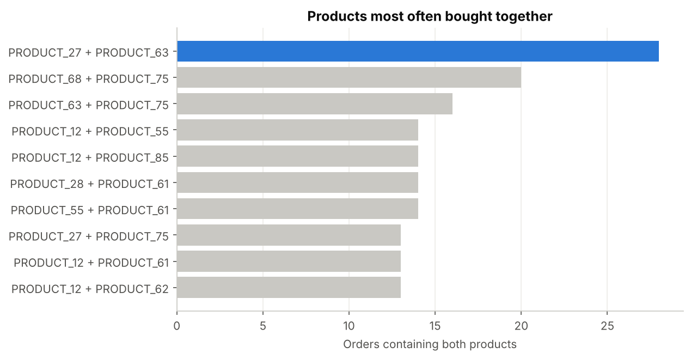
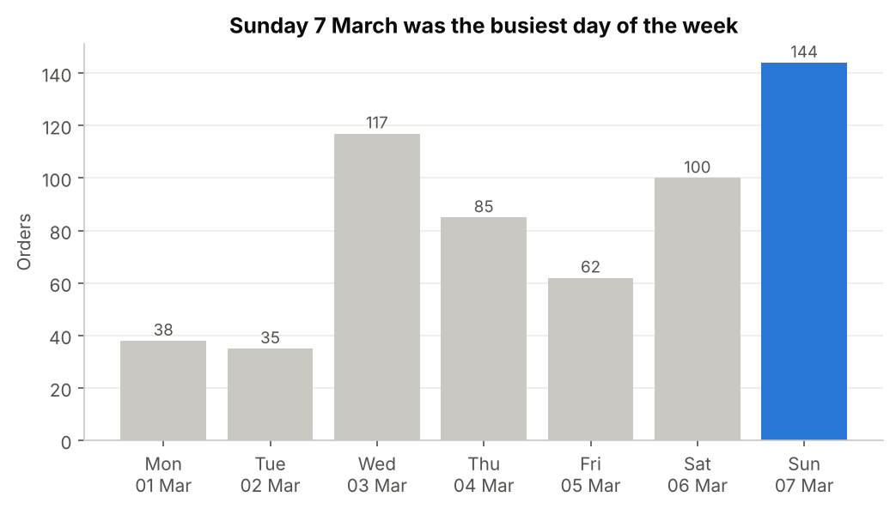
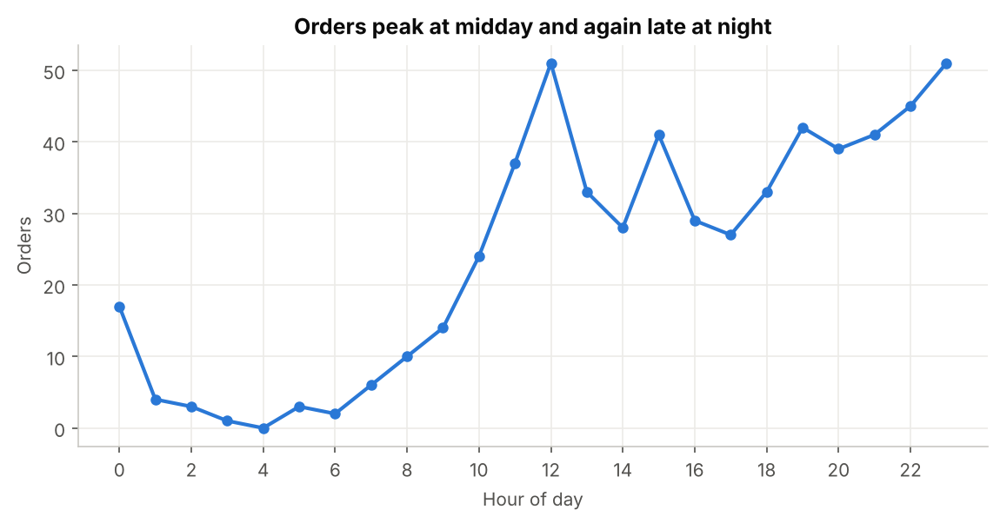
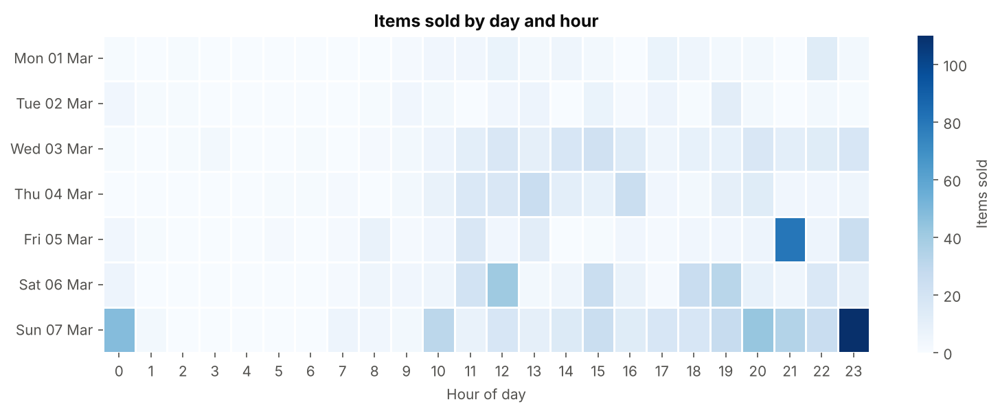
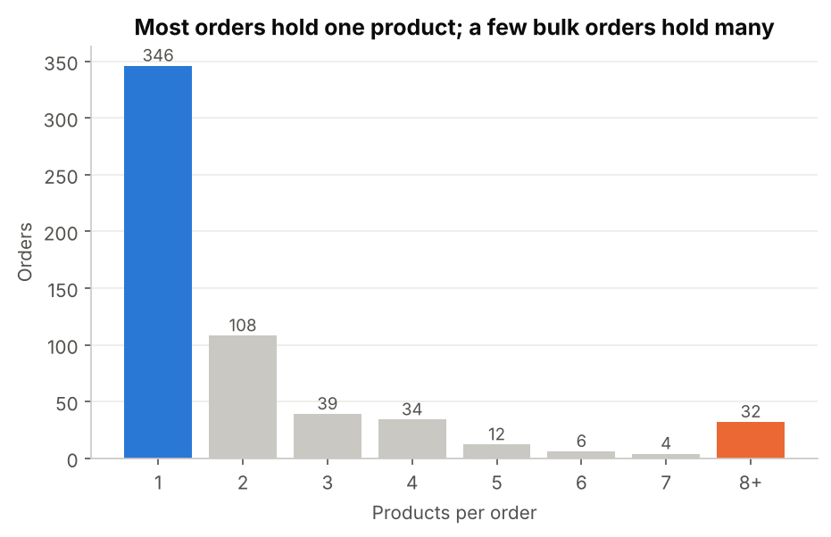
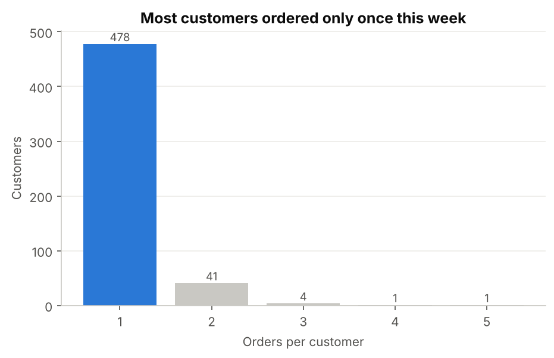

# iPhone Store Sales Transaction Analysis

An end-to-end Python analysis of one week of masked order logs from a phone and accessories store (1–7 March 2021: 581 orders, 1,349 items, 95 products, 525 customers). It finds the best-selling products, the busiest hours and the products customers buy together.

## Tech Skills


## Problem

A store has a raw export of orders: customer, email, a list of products in one text field, and a timestamp. Managers want to use it to plan stock, staffing and promotions, but in this form it can't answer:

1. Which products sell most, and which ones are **bought together**?
2. **When** do customers order — which days and which hours?
3. How large are baskets, and how many customers **come back**?

## Solution

A reproducible Python pipeline ([`src/sales_analysis.py`](src/sales_analysis.py)) that turns the raw export into a clean one-row-per-item table ([`data/processed/order_items_clean.csv`](data/processed/order_items_clean.csv)) and produces 7 charts.

**Data preprocessing and feature engineering**

1. **Data quality:** stripped whitespace from headers, removed duplicate orders, and dropped rows with an invalid date.
2. **Correct date parsing:** dates are day-first (`01/03/2021` = 1 March 2021), so they are parsed with an explicit `DD/MM/YYYY` format.
3. **Product standardisation:** products are separated by `,`, `|` or `;`. All three are unified, then split into a clean list with consistent case and no blanks.
4. **Time features:** date, hour of day and weekday.
5. **Structural transformation:** exploded the data from one row per order to one row per item, the structure needed for product counts and market basket analysis.
6. **Market basket analysis:** generated every product pair inside each order (`itertools.combinations`) and counted the most frequent pairs.

## Key Metrics Tracked

- Units sold per product (top 15)
- Orders per day and per hour; items sold by day × hour
- Top 10 co-purchased product pairs
- Basket size (products per order), including bulk orders of 8+ products
- Orders per customer (one-time vs repeat)

## Screenshots

### What sells, and what sells together
<p>


</p>

### When customers order
<p>


</p>


### Baskets and customers
<p>


</p>

## Key Insights Found

- **Three products drive over a fifth of sales.** PRODUCT_75 (121 units), PRODUCT_63 (97) and PRODUCT_27 (76) make up 21.8% of all units across 95 products.
- **There is a clear cross-sell pair.** PRODUCT_27 and PRODUCT_63 appear together in 28 orders, the strongest pair, followed by PRODUCT_68 + PRODUCT_75 (20).
- **Orders peak twice a day.** Demand rises to a midday peak at 12:00 (51 orders) and builds again in the evening to 23:00 (51 orders). 23.6% of orders arrive between 21:00 and midnight, and only 6.2% between midnight and 08:00.
- **The weekend and midweek are busiest.** Sunday 7 March had 144 orders and Wednesday 3 March had 117, against only 35–38 on Monday and Tuesday.
- **A few bulk orders carry a lot of volume.** 59.6% of orders contain a single product, but 32 orders of 8+ products (5.5% of orders, up to 47 items) account for 30.4% of all items. Most of them were placed late in the evening, which explains the hot spots on Friday at 21:00 and Sunday at 23:00 in the heatmap.
- **Few customers return within the week.** 478 of 525 customers ordered once; 9.0% ordered more than once, and the most active (PERSON_470) placed 5 orders.

## Recommendations

1. **Keep PRODUCT_75, 63 and 27 in stock first**, since they carry over a fifth of unit sales.
2. **Bundle PRODUCT_27 with PRODUCT_63** (and PRODUCT_68 with PRODUCT_75), or show them as "frequently bought together".
3. **Staff and run promotions around 11:00–13:00 and 19:00–23:00**, and on Wednesdays and weekends.
4. **Treat bulk buyers as a separate segment** with volume pricing or an account manager. Late-night bulk orders also need fulfilment ready the next morning.
5. **Start a loyalty or second-order offer.** Only 9% of customers came back within the week.

## Data Limitations

- The data covers **one week**, so "busiest day" means a specific date, not a weekly pattern; more weeks are needed to confirm the weekday trend.
- Names, emails and products are masked, and there are **no prices**, so revenue and margin cannot be analysed.
- Pair counts show co-occurrence, not cause; support, confidence and lift would measure association strength.

## What changed in v2

v1 parsed dates month-first, which spread this one-week file over seven months (3 January to 3 July) and produced weekday results for the wrong days. v2 parses dates day-first, adds the bulk-order and repeat-customer analysis, and writes a clean processed file from the script.

## Tech Stack

- **Python** — core language
- **Pandas, NumPy** — cleaning, reshaping (explode), aggregation
- **itertools, collections.Counter** — product-pair generation and counting
- **Matplotlib, Seaborn** — visualisation
- **VS Code, PowerShell** — development and running scripts

## Project Structure

```
iphone_sales_analysis/
├── data/
│   ├── raw/order_details_masked.csv        # original export (one row per order)
│   └── processed/order_items_clean.csv     # clean output (one row per item)
├── src/sales_analysis.py                   # cleaning, features, basket analysis, charts
├── screenshots/                            # charts generated by the script
└── README.md
```

## How to Run

```bash
pip install pandas numpy matplotlib seaborn
python src/sales_analysis.py
```

## Future Improvements

- Calculate support, confidence and lift with the Apriori algorithm (`mlxtend`) to rank bundles properly.
- Build a Power BI dashboard with product and hour slicers.
- Add prices to measure revenue per product and basket value.

## Author

**Aysha Shama** · Data Analyst

[](https://ayshashamamusamil.netlify.app/)
[](https://www.linkedin.com/in/aysha-shama-b5029a229/)
[](mailto:ayshashama003@gmail.com)
[](https://github.com/ayshashama-portfolio)

